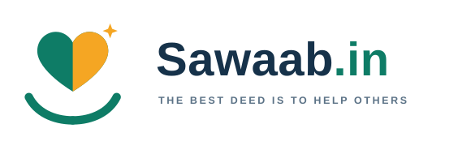

  

# Sawaab.in – Best Deed Do Help ❤️

**"The Best Deed Is to Help Others."**

Sawaab.in is a non-profit initiative dedicated to making a positive difference in society by supporting underprivileged and needy individuals. Our mission is to create a better future through access to education, food, and essential support for those who need it most.

We believe that everyone deserves an equal opportunity to learn, grow, and live with dignity.

## 🌟 Our Mission

Our mission is to serve humanity by helping people in need, regardless of their background or circumstances.

We aim to build a compassionate society where no child is deprived of education and no person has to go hungry.

## 🎯 Our Key Initiatives

### 📚 1. Education for Everyone

Education is the foundation of a better future. We aim to support children from economically weaker backgrounds by:

- Providing educational materials, books, and stationery.
- Supporting children who cannot afford basic educational resources.
- Encouraging access to quality education.
- Promoting awareness about the importance of education.
- Helping deserving students pursue their academic goals.

### 🍲 2. Food for the Needy

No one should go to bed hungry. We strive to support needy families and individuals through:

- Distributing food and essential grocery supplies.
- Supporting underprivileged families facing food insecurity.
- Organizing food distribution initiatives.
- Helping people in difficult circumstances access basic nutrition.

### 🤝 3. Community Support

We believe that small acts of kindness can create meaningful change.

Our goal is to extend support to vulnerable communities and help individuals overcome everyday challenges through compassion, generosity, and collective efforts.

## 💡 Our Vision

To build a society where:

- Every child has access to education.
- Every family has access to nutritious food.
- Every individual is treated with dignity and respect.
- People come together to help those who need support.

## ❤️ Be a Part of the Change

Change begins with small steps. Your contribution, whether through volunteering, donations, or spreading awareness, can make a meaningful difference in someone's life.

Together, we can educate a child, feed a family, and spread hope.

## 🎨 Logo & Brand Assets

The official logo lives in the [`logo/`](logo/) folder — open **`logo/preview.html`** in a browser to see the full brand sheet.

| File | Purpose |
|------|---------|
| `logo/sawaab-logo.svg` | Primary horizontal logo (light backgrounds) |
| `logo/sawaab-logo-vertical.svg` | Stacked logo for square placements |
| `logo/sawaab-logo-dark.svg` | Logo for dark backgrounds |
| `logo/sawaab-logo-mono.svg` | Single-colour print / watermark version |
| `logo/sawaab-icon.svg` | Icon-only mark |
| `logo/sawaab-favicon.svg` | Browser favicon |
| `logo/sawaab-social-banner.svg` | 1280×640 banner for GitHub / social |
| `logo/png/` | Ready-to-use PNG exports |

**Meaning:** the heart stands for compassion — its two halves are our two pillars, education (green) and food (amber); the cupped hands represent community support; the spark above stands for hope — the *sawaab* (reward) of every good deed.

## 🌐 Website

Visit us: **[https://sawaab.in](https://sawaab.in)**

## 🤝 Get Involved

We welcome individuals who believe in helping humanity and making society a better place.

You can support our mission by:

- Volunteering your time and skills.
- Contributing towards education initiatives.
- Supporting food distribution programs.
- Sharing our mission with friends and family.

---

### Sawaab.in – Best Deed Do Help ❤️

**The Best Deed Is to Help Others.**

*Together for Humanity. Together for a Better Tomorrow.*
